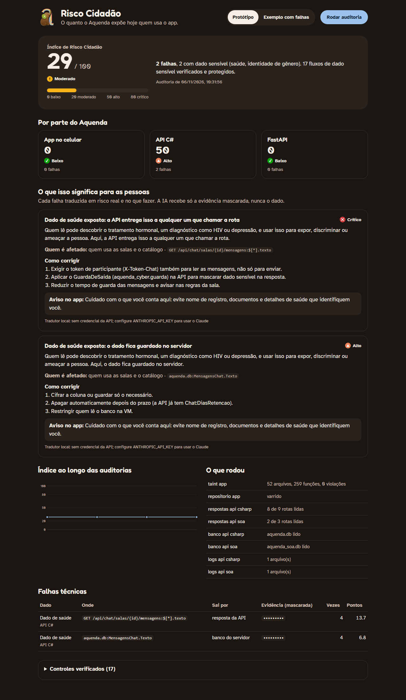
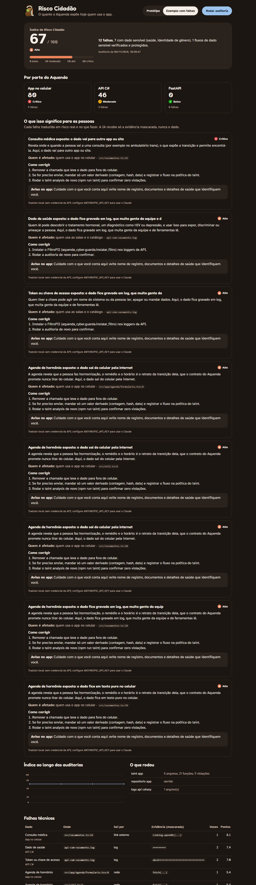

# Aquenda · Segurança e privacidade (Cybersecurity)

Global Solution 2026.2 · FIAP · CitizenTech

O Aquenda é um app para a comunidade LGBTQIAPN+. Ele guarda a agenda de hormônio, as consultas e o PIN do modo discreto, tem salas de conversa e mostra um mapa de serviços. Para quem usa o app, um vazamento pode virar exposição, discriminação ou violência, e não só uma multa da LGPD. Este repositório é o módulo que procura esse risco no próprio Aquenda e mostra o resultado num painel, o **Risco Cidadão**.

| Integrante | RM |
|---|---|
| Giovanne Charelli Zaniboni Silva | 556223 |
| Gustavo Oliveira de Moura | 555827 |
| Lynn Bueno Rosa | 551102 |

Repositórios do protótipo auditado: [app mobile](https://github.com/Lynnbrosa/GS-MOBILE-AQUENDA) (Expo), API C# (.NET) e FastAPI (SOA).



## O que tem aqui

| Missão | Onde | O que faz |
|---|---|---|
| 01 · Mapeamento de PII | `aquenda_cyber/pii/` | Motor de regras que acha CPF, CNS (Cartão SUS), RG, cartão, telefone, e-mail, endereço, CEP, coordenada precisa, data de nascimento, **dado de saúde** (hormônio com dose, HIV, PrEP, CID), **nome de registro** (nome morto), identidade de gênero, **senha/PIN** e tokens. Varre texto, arquivos, pastas, JSON e bancos SQLite. |
| 02 · Taint Analysis | `taint_ts/` | Análise estática do app TypeScript. Segue o dado sensível da fonte (SQLite da agenda, formulário, PIN, GPS) até cada saída insegura (rede, log, link externo, área de transferência, AsyncStorage, notificação). |
| 02 · Bloqueio | `aquenda_cyber/guarda/` e `src/lib/saidaSegura.ts` no app | Travas em tempo de execução: middleware ASGI que mascara ou barra a resposta, filtro de logging e a checagem do app antes de qualquer `fetch`. |
| 03 · Tradução via IA | `aquenda_cyber/ia/remediacao.py` | O Claude transforma cada falha técnica num alerta claro: o risco para a pessoa, quem é afetado, a gravidade, como corrigir e um aviso para o app. O modelo recebe só a evidência mascarada. |
| Dashboard | `aquenda_cyber/painel/` | Painel web com o índice Risco Cidadão (0 a 100), a nota por componente, os alertas, o histórico, as falhas e os controles verificados. |

## Como rodar

Requisitos: Python 3.11+ e Node 18+.

```bash
python -m venv .venv
```

```bash
.venv/Scripts/pip install -r requirements.txt
```

```bash
npm install
```

O app mobile fica na pasta vizinha `../GS-MOBILE-AQUENDA`, que é o padrão dos comandos. Os outros caminhos vão por opção.

```bash
.venv/Scripts/python -m pytest
```

```bash
.venv/Scripts/python -m aquenda_cyber varrer "CPF 529.982.247-25, tomo estradiol 2mg"
```

```bash
.venv/Scripts/python -m aquenda_cyber taint ../GS-MOBILE-AQUENDA
```

```bash
.venv/Scripts/python -m aquenda_cyber taint taint_ts/exemplos/vulneravel
```

```bash
.venv/Scripts/python -m aquenda_cyber auditar --exemplo
```

```bash
.venv/Scripts/python -m aquenda_cyber painel
```

O painel abre em http://localhost:8600. Com a API C# (porta 5000) e a FastAPI (porta 8000) rodando, a auditoria também chama as rotas de verdade. Sem elas, o painel audita o que estiver disponível e diz o que não rodou. Opções da auditoria e do painel:

| Opção | Para quê |
|---|---|
| `--app` | pasta do app Expo |
| `--api-csharp`, `--api-soa` | URL base das APIs (vazio para não chamar) |
| `--banco-csharp`, `--banco-soa` | arquivo SQLite de cada API |
| `--log-csharp`, `--log-soa` | log de cada API (pode repetir) |
| `--sem-ia` | usa só o tradutor local |

Para gerar o ZIP da entrega em `dist/GS-CYBER-AQUENDA.zip`:

```bash
.venv/Scripts/python -m aquenda_cyber empacotar
```

### Ligar o Claude

A tradução usa o Claude quando existe a variável `ANTHROPIC_API_KEY`:

```bash
export ANTHROPIC_API_KEY=sk-ant-...
```

Sem a chave, sem rede ou se o modelo recusar, o painel usa o tradutor local. O cartão do alerta diz qual dos dois gerou o texto. As respostas ficam em `saida/cache_ia.json`, para não pagar duas vezes pela mesma falha.

## 01 · Mapeamento de PII

O motor (`MotorPII`) tem uma regra por tipo de dado (`aquenda_cyber/pii/regras.py`). Cada achado traz a categoria da LGPD (dado pessoal, dado sensível ou credencial), a confiança, o motivo em português e a evidência já mascarada. O texto original nunca sai do motor.

Para achar o dado certo e não apontar coisa que não é dado:

- **Validação de verdade.** O CPF precisa ter os dígitos verificadores certos, o CNS passa no módulo 11, o cartão passa no Luhn e o telefone precisa ter um DDD que existe. A senha e o token passam por um corte de entropia.
- **Normalização.** O texto passa por NFKC e perde os caracteres invisíveis antes da busca. Um CPF com dígitos de largura total ou um zero-width no meio continua sendo achado, e a posição volta para o texto original.
- **Contexto.** RG e endereço só contam com uma palavra de contexto por perto. Dado de saúde precisa de um sinal de que é sobre alguém: medicamento com dose, "deu positivo", "meu resultado". Por isso "Preparar o paciente" e "Atender pacientes do CAPS" não viram falso positivo, e há testes para os dois.
- **O que é do Aquenda.** O motor conhece o vocabulário de quem usa o app: estradiol, testosterona, espironolactona, ciproterona, PrEP, PEP, TARV, hormonização, nome de registro, nome morto.
- **Placeholders.** `changeme`, `<senha>`, `exemplo` e `TOKEN-DE-TESTE` não contam como segredo.
- **Estruturas.** Em JSON e no SQLite, o nome do campo também conta (`cpf`, `senha`, `nome_registro`), e o banco é aberto só para leitura.

Testes em `tests/test_pii.py`: 38 casos, alguns com o Hypothesis (testes por propriedade). O Hypothesis achou um limite real: trocar um dígito da base de um CPF às vezes gera outro CPF válido. Por isso a propriedade testada é a troca dos dígitos verificadores, e o limite está documentado num teste.

Exemplo (`docs/evidencias/pii-varrer-texto.txt`):

```
CPF: •••.•••.•••-25  (95%) Número de 11 dígitos com dígitos verificadores de CPF válidos.
Dado de saúde: •••••••••  (95%) Medicamento (estradiol) com dose por perto: diz o tratamento de alguém.
Nome de registro (nome morto): J•••  (95%) Nome de registro de uma pessoa trans, escrito ao lado de 'nome de registro'.
Cartão Nacional de Saúde (CNS): •••••••••••••00  (95%) Número de 15 dígitos que passa na verificação do Cartão SUS.
Senha ou PIN: •••••••••  (90%) Valor escrito logo depois de 'senha' ou 'PIN'.
```

## 02 · Taint Analysis

`taint_ts/analisar.mjs` usa o compilador do TypeScript (com o TypeChecker) para ler o app inteiro. O que conta como fonte, saída, sanitizador e fluxo permitido está em `taint_ts/politica.json`. Assim, a regra de privacidade fica escrita num lugar só e pode ser revisada.

Como a análise funciona:

- **Sensível a campo.** Ela sabe que `lembrete.id` não é sensível, mas `lembrete.anotacao` é.
- **Entre funções.** Cada função ganha um resumo, ou seja, qual parâmetro chega a qual saída e o que ela devolve. Os resumos são calculados até estabilizar (ponto fixo). Isso pega um vazamento que passa por um utilitário genérico, como `resumoDoDia()` → `enviar()` → `fetch`, sem marcar como sensível tudo o que chama esse utilitário.
- **React.** Ela segue `useState`, `useMemo`, callbacks de `.map` e `.then`, e o estado do formulário da agenda.
- **Sanitizadores.** `digestStringAsync`, `toFixed` na coordenada e as funções que montam o texto discreto da notificação limpam o dado. Um fluxo permitido pela política (por exemplo, agenda → notificação) só passa se o dado foi sanitizado no caminho.
- **Trilha.** Cada violação mostra o caminho, linha por linha.

Resultados:

| Alvo | Arquivos | Funções | Violações | Fluxos permitidos |
|---|---|---|---|---|
| App Aquenda (`../GS-MOBILE-AQUENDA`) | 52 | 259 | **0** | 17 |
| Exemplo com falhas (`taint_ts/exemplos/vulneravel`) | 5 | 21 | **9 de 9** | 1 |

O exemplo tem nove vazamentos plantados e cinco casos limpos. A análise pega os nove e não marca nenhum caso limpo: agenda indo para a rede, para o `console.log` e para o AsyncStorage; consulta indo num link externo; PIN no log; GPS preciso indo para a rede; texto do formulário saindo por `fetch`. A trilha completa está em `docs/evidencias/taint-exemplo-vulneravel.txt`.

O teste de mutação (`tests/test_taint.py`) copia o app de verdade, insere um `fetch` com a agenda e confere que a análise passa a acusar a violação. O zero do app é resultado da análise, não da falta dela.

### Bloqueio em tempo de execução

A análise estática acha o problema no código. As travas seguram o que escapar:

- **`GuardaDeSaida`** é um middleware ASGI para a FastAPI. Ele varre o JSON de cada resposta e mascara o dado sensível ou barra a resposta inteira com `502` (ProblemDetails). O cabeçalho `x-aquenda-pii` diz quantos achados houve. Rotas públicas (o telefone de um CRAS, por exemplo) ficam na lista de permitidos.
- **`FiltroPII`** entra nos loggers, e o log grava só a versão mascarada.
- **`saida_segura()`** checa o valor antes de mandar para um destino que não deveria receber dado sensível.
- **No app**, `src/lib/saidaSegura.ts` roda dentro de `pedirJson`. Se o corpo da requisição tem CPF, CNS, cartão, dado de saúde, nome de registro ou senha, a chamada nem sai do celular e vira `ErroApi('bloqueado')`. O app tem testes para isso.

`python exemplos/demo_guarda.py` mostra a mesma rota sem guarda, mascarando e bloqueando (`docs/evidencias/guarda-demo.txt`).

## 03 · Tradução via IA

`aquenda_cyber/ia/remediacao.py` chama o `claude-opus-5-5` com saída estruturada (Pydantic). O resultado é um `AlertaCidadao` com estes campos:

- `titulo`
- `risco_para_a_pessoa`: o que pode acontecer com quem teve o dado exposto
- `quem_e_afetado`
- `gravidade`: baixa, média, alta ou crítica
- `como_corrigir`: passos para a equipe
- `aviso_no_app`: o texto que pode aparecer para quem usa o app

Decisões:

- **O modelo nunca vê o dado.** O payload leva o tipo do dado, a categoria da LGPD, por onde sai, quantas vezes apareceu e a evidência mascarada (`•••.•••.•••-25`). Há um teste que confere que o CPF original não está no que vai para a API.
- **O tom é de quem cuida.** O prompt de sistema pede linguagem simples, sem culpar a pessoa usuária e sem jargão. O risco é explicado pelo que significa para alguém LGBTQIAPN+: ser exposta, discriminada, ameaçada.
- **Sempre tem resposta.** Sem chave, sem rede, com limite de uso ou com recusa do modelo, o tradutor local gera o alerta com as mesmas regras de gravidade. O cartão do painel diz se o texto veio do Claude ou do tradutor local.
- **Custo.** Usa `effort: low`, só traduz as 8 falhas mais graves por auditoria e guarda o resultado em cache.

## Dashboard executivo · Risco Cidadão

A auditoria (`aquenda_cyber/auditoria.py`) junta tudo num modelo único de falha. Ela olha a taint analysis do app, as respostas das duas APIs, os dois bancos, os logs e o repositório. Cada falha ganha pontos:

```
pontos = impacto da categoria × peso da exposição × confiança × (1 + log10(ocorrências))
índice = 100 × (1 − e^(−pontos / escala))
```

O índice global usa escala 60 e o de cada componente usa 30. As faixas são 0–19 baixo, 20–49 moderado, 50–79 alto e 80–100 crítico. Uma falha num dado sensível exposto numa API aberta pesa muito mais do que um telefone guardado no banco.

O painel segue boas práticas de visualização de dados:

- o número principal em destaque, com a régua das faixas;
- a cor de status sempre junto de ícone e texto, nunca só a cor;
- um gráfico de linha do histórico, com tooltip e foco por teclado;
- tabelas para quem prefere ler os números;
- modo escuro;
- a mesma paleta da logo do Aquenda.

| Protótipo | Exemplo com falhas |
|---|---|
|  |  |

### Resultado da auditoria do protótipo (06/11/2026)

**Risco Cidadão 29/100, moderado.** App 0, FastAPI 0, API C# 50.

| Falha | Onde | Situação |
|---|---|---|
| Dado de saúde nas mensagens das salas, lido por uma rota sem autenticação | `GET /api/chat/salas/{id}/mensagens` (API C#) | Aberta. O token de participante (`X-Token-Chat`) é exigido para enviar, mas não para ler. |
| O mesmo texto guardado em claro | `aquenda.db: MensagensChat.Texto` | Aberta. Correção sugerida: cifrar a coluna ou guardar só o necessário, apagar no prazo (`Chat:DiasRetencao`) e restringir o acesso ao banco. |

Os dois alertas no painel trazem os passos de correção. Os 17 fluxos de dado sensível do app que a política permite (token das salas, coordenada arredondada, notificação com texto discreto) aparecem em "Controles verificados".

O exemplo com falhas dá **67/100, alto**: o app fica crítico com as 9 violações, e o log plantado tem CPF, token e dado de saúde.

## Evidências

Tudo em `docs/evidencias/`:

| Arquivo | O que mostra |
|---|---|
| `painel-prototipo.png` | o painel do protótipo, com o índice Risco Cidadão |
| `painel-exemplo.png` | o painel do exemplo com falhas |
| `taint-app-aquenda.txt` | a taint analysis no app real: 0 violações, 17 fluxos permitidos |
| `taint-exemplo-vulneravel.txt` e `.json` | as 9 violações com a trilha de cada uma |
| `pii-varrer-texto.txt`, `pii-varrer-log.txt` | o motor de PII num texto e num log |
| `guarda-demo.txt` | a resposta da API sem guarda, mascarada e bloqueada |
| `testes.txt` | os 63 testes passando |

## Roteiro do vídeo (até 3 min)

1. **0:00** O problema: no Aquenda, vazar o nome de registro ou a agenda de hormônio expõe a pessoa, e não só um CPF.
2. **0:20** O motor de PII rodando no terminal (`varrer`) num texto com CPF, estradiol com dose e nome de registro, com o texto redigido.
3. **0:50** A taint analysis no exemplo: as 9 violações e a trilha de uma delas, da agenda até o `fetch`. Depois no app real: zero violações e 17 fluxos permitidos.
4. **1:30** As travas: `demo_guarda.py` mascarando e bloqueando com 502.
5. **1:50** O painel: o índice 29 do protótipo, a falha do chat explicada para pessoas e a troca para o exemplo (67). Clicar em "Rodar auditoria" e ver o histórico mudar.
6. **2:40** Fechamento: o que falta corrigir na API C# e como ligar o Claude.

## Estrutura

```
aquenda_cyber/
  pii/          normalização, validadores, regras, motor
  taint/        chama o analisador em Node a partir do Python
  guarda/       GuardaDeSaida, FiltroPII, saida_segura
  ia/           tradução das falhas em alerta (Claude + tradutor local)
  painel/       FastAPI e página do painel
  auditoria.py  modelo de falha, pontuação e índice
  __main__.py   linha de comando
taint_ts/
  analisar.mjs  análise de taint com a API do compilador TypeScript
  politica.json fontes, saídas, sanitizadores e fluxos permitidos
  exemplos/     app de exemplo com vazamentos plantados
exemplos/       log vulnerável e demonstração das travas
tests/          63 testes (pytest + Hypothesis)
docs/evidencias prints e saídas
```
